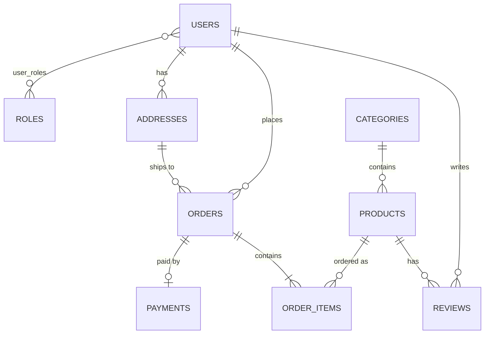

# MarketHub — REST API интернет-магазина

Backend интернет-магазина электроники на **Java 25 + Spring Boot 4**: каталог с поиском, заказы со складской логикой, оплата и возвраты, отзывы с отметкой «подтверждённая покупка», три роли и JWT.

Подробное техническое задание и обоснование актуальности — в [docs/TZ.md](docs/TZ.md).

## Стек

| | |
|---|---|
| Язык / фреймворк | Java 25, Spring Boot 4.1.1 (Spring Framework 7, Spring Security 7, Hibernate 7) |
| Сборка | Maven |
| БД | PostgreSQL 17, Spring Data JPA; H2 для тестов и dev-профиля |
| Миграции | Flyway |
| Безопасность | Spring Security, JWT (HS256) через OAuth2 Resource Server, BCrypt |
| Наблюдаемость | Логирование запросов с `X-Request-Id`, Actuator, Micrometer + Prometheus |
| Тесты | JUnit 5, Mockito, MockMvc, AssertJ; покрытие JaCoCo ≥ 70 % |

## Запуск

Нужны JDK 25 и Maven 3.9+.

**Быстро, без PostgreSQL** (БД в памяти):

```bash
mvn spring-boot:run -Dspring-boot.run.profiles=dev
```

**С PostgreSQL:**

```bash
docker compose up -d db          # только база
mvn spring-boot:run              # приложение на http://localhost:8080
```

**Полностью в Docker:** `docker compose up --build`.

При первом запуске создаются учётные записи (пароли задаются переменными окружения `ADMIN_PASSWORD`, `MANAGER_PASSWORD`):

| Логин | Пароль по умолчанию | Роль |
|---|---|---|
| `admin` | `admin123` | ADMIN |
| `manager` | `manager123` | MANAGER |

Покупатели регистрируются сами через `POST /api/auth/register`. Готовые примеры запросов — в [requests.http](requests.http).

## Тесты и покрытие

```bash
mvn verify
```

Запускает unit- и интеграционные тесты, строит отчёт `target/site/jacoco/index.html` и **проваливает сборку, если покрытие строк ниже 70 %**. То же самое выполняется в GitHub Actions при каждом пуше.

- **Unit-тесты** (`src/test/.../service`, `security`, `entity`, `logging`) — бизнес-логика сервисов на Mockito: списание остатков, переходы статусов, права доступа, JWT.
- **Интеграционные тесты** (`src/test/.../web`) — поднимают полный контекст Spring с H2 и миграциями Flyway и гоняют настоящие HTTP-запросы через MockMvc вместе со Spring Security: от регистрации до оплаты, доставки и отзыва.

## Модель данных



9 сущностей: `User`, `Role`, `Category`, `Product`, `Address`, `Order`, `OrderItem`, `Payment`, `Review`. Схема создаётся миграциями Flyway (`src/main/resources/db/migration`), Hibernate её только использует (`ddl-auto: none`).

## Архитектура

```
web/          REST-контроллеры + GlobalExceptionHandler (RFC 9457 Problem Details)
service/      бизнес-логика и транзакции
repository/   Spring Data JPA (derived queries, JPQL, Specifications)
entity/       JPA-сущности
dto/          запросы/ответы (record), сущности наружу не отдаются
security/     выпуск JWT, текущий пользователь из токена
config/       Spring Security, свойства, создание админа при старте
logging/      фильтр логирования запросов
```

## API

Ошибки возвращаются в едином формате `application/problem+json` с HTTP-кодами 400 / 401 / 403 / 404 / 409.

| Метод | Путь | Доступ | Описание |
|---|---|---|---|
| POST | `/api/auth/register` | все | Регистрация покупателя, возвращает JWT |
| POST | `/api/auth/login` | все | Вход, возвращает JWT |
| GET | `/api/auth/me` | авторизованные | Текущий пользователь |
| GET | `/api/categories`, `/api/categories/{id}` | все | Категории |
| POST, PUT, DELETE | `/api/categories[/{id}]` | MANAGER, ADMIN | Управление категориями |
| GET | `/api/products?categoryId&q&minPrice&maxPrice&page&size&sort` | все | Поиск по каталогу |
| GET | `/api/products/{id}` | все | Товар с рейтингом |
| POST, PUT, DELETE | `/api/products[/{id}]` | MANAGER, ADMIN | Управление товарами |
| GET | `/api/products/{id}/reviews`, `/api/reviews/{id}` | все | Отзывы |
| POST | `/api/products/{id}/reviews` | авторизованные | Оставить отзыв |
| PUT / DELETE | `/api/reviews/{id}` | автор / автор или сотрудник | Изменить / удалить отзыв |
| GET, POST, PUT, DELETE | `/api/addresses[/{id}]` | владелец | Адреса доставки |
| GET | `/api/orders?status` | авторизованные | Свои заказы (сотрудники — все) |
| GET | `/api/orders/{id}` | владелец, сотрудник | Заказ |
| POST | `/api/orders` | авторизованные | Оформить заказ |
| PUT | `/api/orders/{id}` | владелец | Сменить адрес доставки |
| PATCH | `/api/orders/{id}/status` | MANAGER, ADMIN | Сменить статус |
| POST | `/api/orders/{id}/cancel` | владелец, сотрудник | Отменить заказ |
| DELETE | `/api/orders/{id}` | ADMIN | Удалить отменённый заказ |
| POST | `/api/payments` | владелец заказа | Оплатить заказ |
| GET | `/api/payments/{id}` | владелец, сотрудник | Платёж |
| GET | `/api/payments` | MANAGER, ADMIN | Все платежи |
| POST | `/api/payments/{id}/refund` | MANAGER, ADMIN | Возврат |
| GET, POST, PUT, DELETE | `/api/users[/{id}]`, `PUT /api/users/{id}/roles` | ADMIN | Пользователи и роли |
| GET | `/api/roles` | ADMIN | Справочник ролей |
| GET | `/actuator/health`, `/actuator/info` | все | Состояние сервиса |
| GET | `/actuator/metrics`, `/actuator/prometheus`, `/actuator/loggers`, `/actuator/flyway` | ADMIN | Метрики и диагностика |

`OrderItem` не имеет своего контроллера: позиции создаются и удаляются вместе с заказом. Платёж не удаляется отдельно, так как это финансовая история.

## Логирование и метрики

- Каждый HTTP-запрос пишется в лог: метод, путь, статус, время выполнения. Запросу присваивается `requestId` — он есть во всех строках лога этого запроса и возвращается клиенту в заголовке `X-Request-Id`.
- Логи пишутся в консоль и в `logs/markethub.log` с ротацией (10 МБ, 7 файлов).
- Бизнес-метрики: `markethub.orders.created`, `markethub.orders.cancelled`, `markethub.payments.completed` — доступны в `/actuator/metrics` и в формате Prometheus.

## Соответствие требованиям лабораторной

| Требование | Где |
|---|---|
| ≥ 7 сущностей со связями | 9 сущностей, все типы связей — `entity/` |
| CRUD-контроллеры | `web/` — для всех сущностей, кроме `OrderItem` (управляется через заказ) |
| Авторизация и аутентификация по ролям | `config/SecurityConfig`, `@PreAuthorize`, проверки владельца в сервисах |
| Java 25, Spring Boot 4.x | `pom.xml` |
| Maven | `pom.xml` |
| Spring Web | `web/` |
| SQL + Spring Data JPA | PostgreSQL / H2, `repository/` |
| Spring Security + JWT | `config/SecurityConfig`, `security/JwtService` |
| Тесты, покрытие 70 % | `src/test/`, JaCoCo `check` в `pom.xml` |
| Flyway | `db/migration/V1..V3` |
| Логирование запросов и Actuator | `logging/RequestLoggingFilter`, `application.yml` (`management.*`) |
| GitHub | `.github/workflows/ci.yml` |
